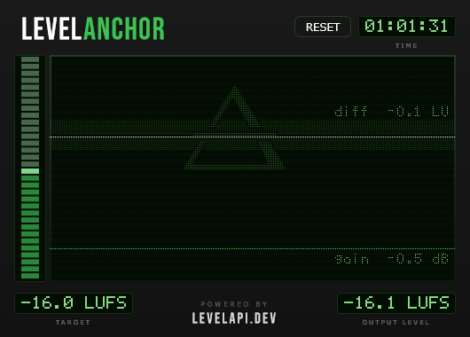

# LevelAnchor

A Windows VST plugin that holds a live audio source's loudness on a LUFS target, in real time.

LevelAnchor measures programme loudness continuously and modulates output gain to keep it on
the target you set. It moves the level, slowly enough to stay inaudible, and most of the time
leaves the dynamics alone. Only a sudden jump gets a brief cut and a gentle compressor, until
the level ride catches up. Set a target, leave it running, and the source stays where you put
it.

It is built for streamers, primarily OBS Studio, and it is a showcase of **LevelAPI**, the
loudness engine doing the actual work, which is licensed separately (see
[The engine](#the-engine-and-why-it-is-not-in-this-repository) below).

**To just use the plugin**, take the signed installer or the VST2 ZIP from the
[latest release](https://github.com/tlemon-com/LevelAnchor/releases/latest). The
[LevelAnchor plugin page](https://levelapi.dev/levelanchor/?ref=github) has the install guide,
an OBS setup walkthrough and the free-use terms.

**To see it working first**, there is a short video: [the same stream before and after, then the
OBS setup](https://www.youtube.com/watch?v=pQphGZ2-RlU) (2:44).

## What it does

- **One control.** A LUFS target, -24 to -8, default -16, set from the 32-LED strip on the left.
- **Shows its work.** Scrolling deviation trace against a fixed target line, the gain currently
  being applied, the integrated output level, deviation from target, and a session timer. An
  amber PEAK light, and amber marks on the gain trace, show when the peak stage is holding the
  level down.
- **Will not clip.** After the gain change, the signal passes through a peak stage ending in a
  true-peak limiter (4x oversampled) with its ceiling at -1 dBTP, per EBU R 128, so anchoring a
  quiet source upward cannot push peaks into clipping.
- **Runs unattended.** The plugin does its job with the UI closed, which is how it is normally used.
- **Entirely local.** No network code of any kind: no telemetry, no accounts, no activation, no
  update check.

Loudness measurement follows the ITU-R BS.1770 / EBU R 128 lineage. The interesting part is not
the measurement (free meters are everywhere). It is holding a target in real time, when
loudness is only known *after* the audio has played.

## What it is not

- Not a metering suite, and not a mastering chain. It does one job: anchor to a target LUFS
  level.
- Not a limiter, although it contains one. The -1 dB ceiling exists to keep the gain change
  from clipping, not to be driven as a loudness tool.

## What the engine does beyond this plugin

The plugin has one control on purpose. LevelAPI2, the engine underneath it, offers more to
products built on it. Three examples:

- **Rolling calibration for continuous feeds.** The plugin aims the output's loudness since it
  was loaded (or reset) at the target, which suits a stream with a start and an end. The engine
  can aim the last stretch of output at it instead, for channels that never stop.
- **An adjustable true-peak ceiling.** The plugin keeps it at -1 dBTP.
- **Low-latency modes, 2 ms instead of 50 ms.** The released plugin shows them but runs the
  standard mode; a build from this source with a licensed LevelAPI2 library offers every mode.

These are left out of the plugin deliberately, not missing. If your product needs them, see
[LevelAPI2 licensing](https://levelapi.dev/?ref=github#licensing).

## The engine, and why it is not in this repository

The real-time loudness measurement and adjustment core is **LevelAPI2**, a closed-source library.
It is not in this tree and will not be. What *is* here is the entire plugin around it: the JUCE
processor and editor, the pixel-matrix UI, the parameter handling, and (most relevant if you are
evaluating the library) the code that loads LevelAPI2 and calls it from an audio callback.

This repository is a working reference integration rather than a sample: the released binary is
built from this same source, differing only in which linking configuration was used. If you are
here to see how LevelAPI2 is integrated into a real product, start with
[`Source/LevelApiDynamic.h`](LevelAnchor/Source/LevelApiDynamic.h) and its `.cpp`, alongside the
[LevelAPI2 loudness SDK documentation](https://levelapi.dev/manual.html?ref=github), which covers
the C API those files call.

## Distributed files

**The [released plugin](https://github.com/tlemon-com/LevelAnchor/releases/latest)** is a
complete, working build with LevelAPI2 linked in statically. There is
no DLL to install, no key to enter and nothing to configure: drop it in your VST folder and it
works.

**A build you make from this source** uses the dynamic path. It loads LevelAPI2 from its DLL at
runtime, so it needs a copy of the library, which is what a LevelAPI license gets you. Without
one the plugin still compiles, loads and runs; it simply passes audio through unchanged. The
static configurations are published for transparency rather than as a route to take: building
that way needs the library as a static lib, which is a separate arrangement.

So: to *use* LevelAnchor, take the release. To *read or extend* it, build the source. Or get in
touch to put LevelAPI2 in your own project, or to use the LevelAnchor plugin in an organization
with an annual revenue over €500k.

## Two linking paths

Both paths are permanent and both are expected to build. Which one you get is decided by the
`__STATIC_LIB__` define, set per build configuration in `LevelAnchor.jucer`:

| Configuration | Path | Notes |
|---|---|---|
| `Debug`, `Release` | **Dynamic** (the default) | LevelAPI2 is loaded from its DLL at runtime through the C API in `Source/LevelAPI2_dynlib.h`. This is what you build if you clone the repo. |
| `Debug-static`, `Release-static` | **Static** (`__STATIC_LIB__=1`) | How the released binary is built. Needs LevelAPI2 as a static library, which is a separate arrangement. |

`PluginProcessor` holds whichever adjuster the configuration selected behind an identical method
surface, so `processBlock` is shared between the two paths.

## Building

**Requirements**

- Visual Studio 2022, x64
- JUCE 8 (developed against 8.0.4) and the Projucer
- The VST2 SDK 3.6.9. Steinberg no longer licenses VST2, and the SDK is not redistributable, so
  it is not included here; you need your own copy.
- A LevelAPI2 license for the DSP core.

**Steps**

1. Open `LevelAnchor/LevelAnchor.jucer` in the Projucer.
2. Point the JUCE module paths at your own JUCE 8 `modules` folder.
3. Set a `LIBS` environment variable such that `$(LIBS)vst/VST_SDK369/VST2_SDK` resolves to your
   VST2 SDK. It is concatenated without a separator, so `LIBS` must end in one. Or just edit the
   header path in the Projucer to point wherever your SDK lives.
4. Save the project to re-export the Visual Studio files, then build
   `Builds/VisualStudio2022/LevelAnchor.sln`, `Debug` or `Release`, x64.

Note that the configurations carry a post-build step copying the plugin to
`C:\Program Files\VSTPlugins`, which needs an elevated Visual Studio; remove it in the Projucer
if you would rather it did not.

## Running a build you made yourself

None of this applies to the released plugin, which has the library inside it. A build from this
source needs `LevelAPI2-x64.dll` at runtime (`LevelAPI2-x64_d.dll` for Debug builds), looked for
in this order:

1. The `LEVELAPI2_DLL` environment variable: either the DLL itself or the folder holding it.
   A development convenience; nothing in a shipping build depends on it.
2. Next to the plugin binary. This is the deployment answer.
3. The bare filename, which hands the search to Windows.

The LevelAPI2 library expects a certificate. It is taken from `LEVELANCHOR_CERTIFICATE_STR` if
that was defined at build time, otherwise from a `certificate.txt` sitting next to the plugin.

**Getting the library.** LevelAPI2 is not a public download. If you want to build and run
against it, or you are looking at the library for your own product, get in touch through
[the LevelAPI2 loudness library site](https://levelapi.dev/?ref=github).

## In OBS

Add LevelAnchor as a filter on the audio source you want anchored: open the source's pop-up
menu and select `Filters` → `+` → `VST 2.x Plug-in`, then set the target and leave it.
Correction starts on the first block of audio; there is no warmup to wait through.

Then do the same on every source that makes noise: mic, Desktop Audio, anything else that is
live. Leave them all on the same target, and set the balance the way you always did, on the
mixer's volume sliders. OBS has no filter slot on the master output, and per-source is the
better place for it anyway: it is what keeps the balance between sources steady.

The menu path is not obvious the first time; there is a
[step-by-step OBS walkthrough with screenshots](https://levelapi.dev/levelanchor/?ref=github#obs)
if you want it.

## License

Three layers, and they are not the same thing:

- **This source code** is **MIT** licensed; see [LICENSE](LICENSE). Read it, copy from it, build
  it, ship it in your own product. The integration code serves as implementation example.
- **LevelAPI2**, the engine, is closed source and licensed separately on an annual B2B basis. MIT
  covers none of it, it is not in this repository, and a build made from this source does nothing
  useful until you have it. See the
  [LevelAPI2 licence terms](https://levelapi.dev/?ref=github#licensing).
- **The released plugin** is free to use, including on monetized streams and channels. Above
  €500k of annual organization revenue, a LevelAPI license is required: the same license that
  covers the engine. The threshold is a hard line, not a suggestion; below it, there is nothing
  to pay and nothing to sign.

## Support

One-to-one help requires a LevelAPI license. For feedback, and for anything to do with licensing
the engine, go through the
[contact details on the LevelAPI site](https://levelapi.dev/?ref=github#licensing).
